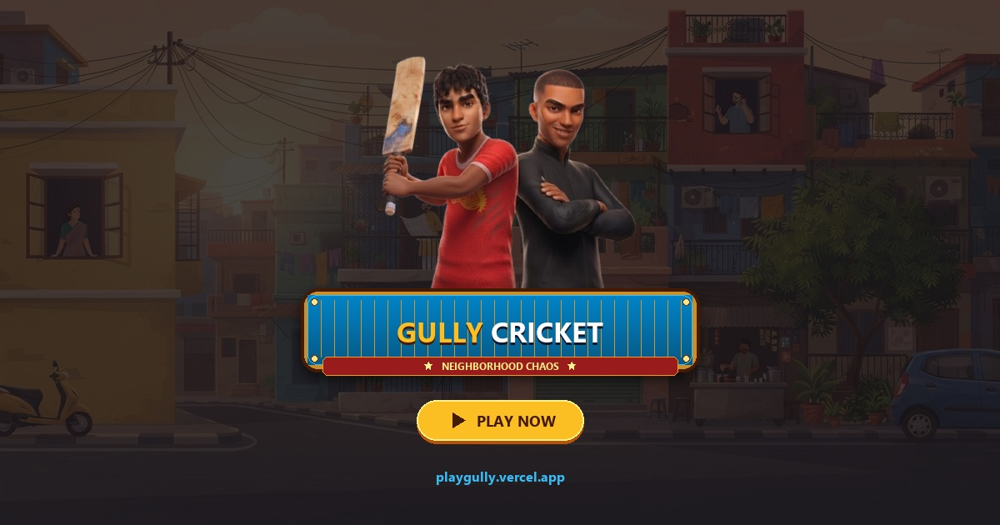

# 🏏 Gully Cricket: Neighborhood Chaos

> **Play Live Now**: [https://playgully.vercel.app/](https://playgully.vercel.app/)

<p align="center">
  
</p>

A browser-based Indian street cricket game built with TypeScript, Canvas 2D, Three.js, and the Web Audio API. Playable directly in modern desktop and mobile browsers.

---

## Features and Gameplay Mechanics

### Core Features
* **Timing-Based Batting**: Swing timing relative to the sweet spot determines whether a shot is a six, four, single, or hazard hit.
* **Balls Faced Tracking**: The HUD and milestone cards display total balls faced alongside the current score.
* **Milestone Overlays**: Popups appear when score crosses 50, 100, 150, and 200 runs with audio fanfare and confetti.
* **3-Ball Life System**: Players start with 3 lives; hitting a hazard or getting bowled costs 1 life, and losing all 3 ends the game.

### Hazards and Targets
* **Parked Car**: Hit on a late swing; plays glass break and car alarm audio, awards 0 runs, and deducts 1 life.
* **Aunty's Window**: Hit on an early lofted shot; plays glass shatter audio, awards 0 runs, and deducts 1 life.
* **AC Unit**: Hit on an early sliced drive; awards 0 runs and deducts 1 life.
* **Newspaper Uncle**: Hit on an early pop-up to the balcony; awards 0 runs and deducts 1 life.
* **Wicket**: Ball passes the batter and crosses the wicket line; plays stump timber clatter audio, awards 0 runs, and deducts 1 life.

---

## How It Works

* **Layer 1 (Canvas 2D)**: Static 2D illustrated street background.
* **Layer 2 (Three.js WebGL)**: 3D animated character meshes with custom toon shading.
* **Layer 3 (Canvas 2D)**: Parabolic ball trajectory, particle effects, and screen-space HUD overlays.
* **Audio**: all sound effects and ambience are synthesised at runtime with the Web Audio API, with no audio files.

---

## Controls

| Action | Desktop | Mobile / Touch |
| :--- | :--- | :--- |
| **Bowl / Bat** | Left Click / `Spacebar` | Tap Screen |
| **Mute / Unmute Audio** | `M` key / Top-right 🔊 icon | Tap Top-right 🔊 icon |
| **Fullscreen Toggle** | `F` key / Top-right ⛶ icon | Tap Top-right ⛶ icon |
| **Debug Mode (Localhost)** | `D` key | `?debug=true` in URL |

---

## Asset Pipeline

Mixamo FBX files with 4K embedded textures were converted to GLB, textures resized and recompressed, and geometry meshopt-compressed.
All nine animation takes were consolidated into a single skeleton file (`anims.glb`).
`public/models` totals 13.81 MB: three character files (batter 4.7 MB, bowler 4.0 MB, fielder 4.0 MB, each mesh plus one 1024px texture) and one shared animation file (1.1 MB).

---

## Tech Stack

* TypeScript
* Vite
* Three.js
* Canvas 2D
* Web Audio API
* glTF-Transform and Meshoptimizer
* Vercel

---

## Local Development

### Prerequisites
* [Node.js](https://nodejs.org/) (v18 or higher)
* `npm`

### Installation
```bash
# Clone the repository
git clone https://github.com/Abhinav-Muralidhar/cricket.git

# Navigate to project directory
cd cricket

# Install dependencies
npm install
```

### Run Dev Server
```bash
npm run dev
```
Open `http://localhost:5173` in your browser.

### Production Build
```bash
npm run build
```
Typechecks with `tsc` and compiles an optimized bundle into `dist/`.

---

## Attributions and Credits

* **3D Character Bases & Skeletal Animations**: [Mixamo by Adobe](https://www.mixamo.com/)
* **Background Environment Artwork**: [Google AI Studio](https://aistudio.google.com/)  
* Source FBX files are not redistributed in this repo, and the character models and animations are used under Adobe's Mixamo terms.

---

## Author

Developed by **Abhinav M** ([GitHub](https://github.com/Abhinav-Muralidhar))